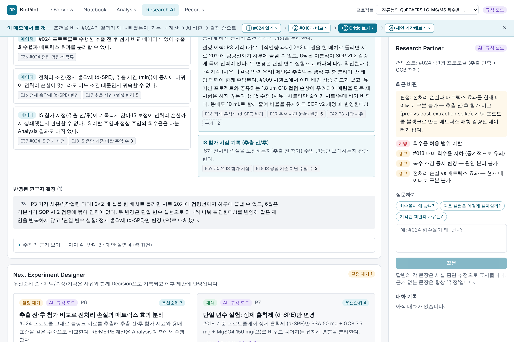
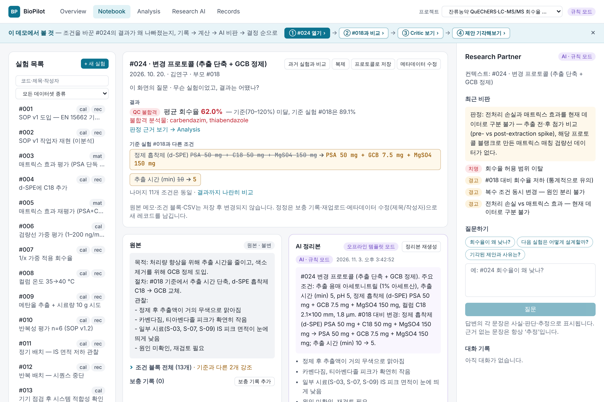
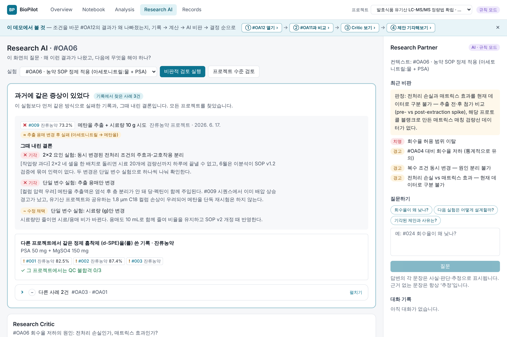
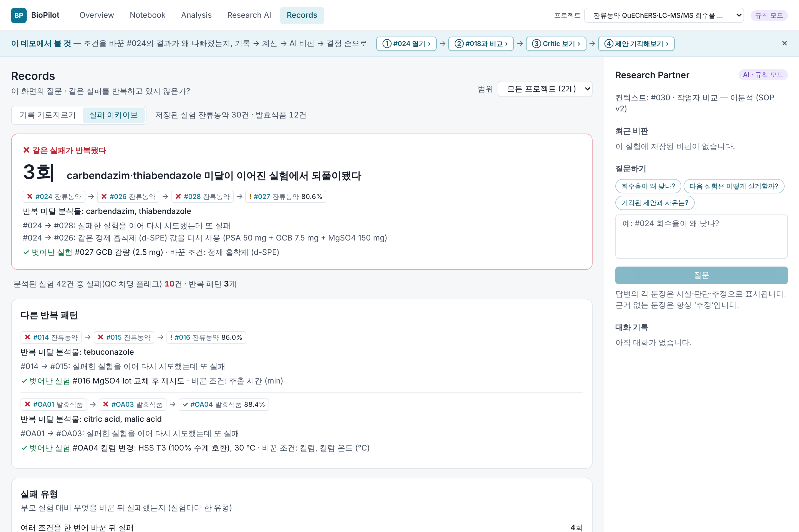
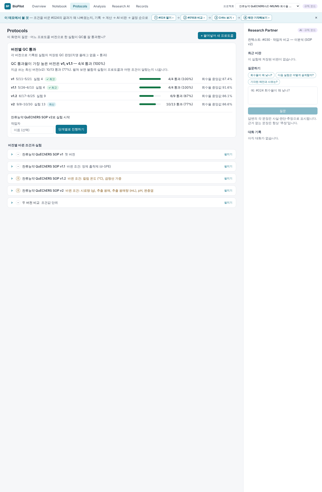
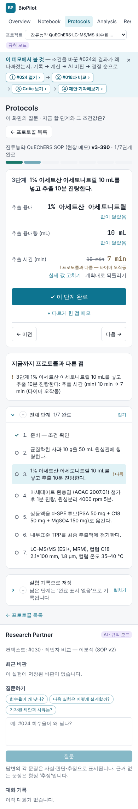

# BioPilot — 연구실의 "왜"를 잊지 않는 AI 연구 파트너

분석화학 실험실을 위한 **ELN → Research Memory → Scientific Analysis → AI Partner**.
실험 기록을 쌓는 데서 멈추지 않고, **왜 조건을 바꿨는지, 왜 AI의 제안을 기각했는지**까지 기록으로 남겨
다음 판단에 다시 쓰이게 만든다.



<sub>Research AI 탭. 넉 달 전 연구자가 "인력이 없다"며 기각한 2×2 요인 실험을 다시 내밀지 않고, 그 사유를 인용하며
단일 변수 실험으로 바꿔 제안한다. 모든 숫자 칩(E16, E17 …)은 저장된 레코드를 가리킨다.</sub>

**데모** (백엔드 없이 실제 API 응답으로 동작하는 읽기 전용 빌드)
- 6개월치 연구실 기록: **https://lifst-coder.github.io/biopilot/?scenario=lab** ← 먼저 보길 권한다
- 단일 시나리오 7개 실험: https://lifst-coder.github.io/biopilot/?scenario=reference

추천 클릭 순서는 [§6](#6-데모-추천-클릭-순서)에 있다. 시간이 3분뿐이라면 화면 위 안내 바의 ①→④를 차례로 누르면 된다
(기록 → 기준 실험과 비교 → AI 비판 → 연구자 결정이 다음 제안에 반영된 모습).

---

## 1. 문제: 연구실에서 증발하는 것

LC-MS/MS 잔류농약 분석법 개발은 수십 번의 "조건 하나 바꿔 보기"로 이루어진다. 그 과정에서 **기록되는 것**과
**증발하는 것**이 갈린다.

| 남는 것 | 증발하는 것 |
|---|---|
| 조건 블록, 장비 CSV, 메모 | 왜 그 조건을 바꿨는가 ("GCB를 넣은 건 색소 때문이었다") |
| 회수율 62% | 그 62%가 기준 실험 대비 무엇 때문에 떨어졌다고 판단했는가 |
| "2×2 요인 실험 안 함" | **왜** 안 했는가 — "6월은 SOP 검증에 묶여 인력이 없다"(과학적 이유가 아니라 일정 문제) |
| 실패한 실험 3건 | 세 번이 같은 원인(흡습된 MgSO4 lot)이었다는 사실 |
| 프로젝트 A의 PSA 사용 이력 | 프로젝트 B가 같은 PSA를 쓰려 할 때 그 이력이 있다는 사실 |

이런 암묵지는 사람의 머릿속이나 회의록에 있다가, 담당자가 바뀌거나 몇 달이 지나면 사라진다. 그 결과
**같은 제안이 다시 나오고, 같은 실패가 반복되고, 일정 때문에 미룬 실험이 "과학적으로 안 되는 실험"으로 굳어진다.**

AI를 붙이면 문제가 더 커질 수도 있다. 언어 모델은 그럴듯한 숫자를 지어내고, 연구자가 이미 기각한 제안을
자신 있게 다시 내놓는다. 실험 기록에서 그것은 치명적이다.

## 2. 기존 전자연구노트(ELN)와 무엇이 다른가

| | 일반 ELN | BioPilot |
|---|---|---|
| 기록 단위 | 실험 페이지(서식 있는 문서) | **불변 원본**(메모·조건 블록·CSV) + 별도 레코드로 쌓이는 정리본·계산·비판·결정 |
| 수정 | 페이지를 고친다(이력은 버전 비교로) | 원본은 고칠 수 없다. 정정은 보충 기록·메타데이터 개정 이력으로 **추가**된다 |
| 숫자 | 사람이 엑셀에서 계산해 붙여 넣는다 | 저장된 CSV에서 **결정론적 코드**가 계산하고, 입력 지문(sha256)과 함께 저장한다 |
| 검색 | 제목·본문 키워드 | 조건값·분석물·결과·비판·결정 사유까지, **프로젝트를 가로질러** 회상한다 |
| AI | 요약·작문 보조 | 저장된 근거만 인용하는 비판·가설·다음 실험 설계. 근거 없는 숫자가 하나라도 있으면 쓰지 않는다 |
| 연구자의 판단 | 기록되지 않거나 자유 메모 | 제안마다 **채택·수정·기각 + 사유**가 불변 레코드로 남고, 이후 모든 제안에 반영된다 |

한 문장으로: ELN이 "무엇을 했는가"를 저장한다면, BioPilot은 **"왜 그렇게 했고 왜 다른 것은 하지 않았는가"**를
저장하고, 그것을 다음 판단의 입력으로 되돌린다.

## 3. 화면으로 보는 BioPilot

| | |
|---|---|
|  |  |
| **Notebook** — 기준 실험 #018과 다른 조건 2개, 저장된 결과(QC 불합격, 불합격 분석물)를 먼저 보여준다. 원본 메모와 AI 정리본은 나란히, 서로 다른 레코드로 있다. | **교차 프로젝트 회상** — 유기산 프로젝트의 #OA06을 열면, 잔류농약 프로젝트에서 같은 흡착제를 쓴 기록과 **그때 내린 결론(기각 사유 포함)**이 비판 위에 먼저 나온다. |
|  |  |
| **Research Critic + 결정 반영** — "현재 데이터로 확정 불가"의 이유와 누락 대조군, 그리고 과거 기각 사유를 반영해 대체한 제안. | **Records · 실패 아카이브** — 쌓인 기록에서만 보이는 것: 같은 실패의 반복(#014→#015→#016), 작업자 차이, 기록 공백. |
|  |  |
| **Protocols · 버전 계보** — SOP v1 → v1.1 → v1.2 → v2 중 어느 버전으로 한 실험이 저장된 QC를 잘 통과했는지가 맨 위에. 버전을 펼치면 불합격 실험이 SOP와 어떤 조건이 달랐는지 나온다. | **Protocols · 붙여넣기와 실행** — 붙여넣은 프로토콜 원문에서 **적힌 값만** 조건으로 읽고(범위·모호한 값은 비워 둔다) 확인 후 저장. 실험대에서는 휴대폰 폭으로 단계를 체크하고, 끝내면 실제 값과 "프로토콜과 다른 점"이 그대로 실험 기록이 된다. |

## 4. 아키텍처

```
 연구자 입력                                                              연구자 결정 + 사유
     │                                                                          ▲   │
     ▼                                                                          │   ▼
┌──────────┐  DTO   ┌─────────────┐        ┌───────────────┐  Evidence  ┌──────┴──────┐
│ L1  ELN  │──────▶│ L2 Memory   │──────▶ │ L3 Analysis   │──────────▶│ L4 Partner  │
│ 원본 기록 │        │ 계보·diff·  │  diff  │ 결정론적 계산  │  metrics   │ 비판·가설·  │
│ (불변)   │───────────────────────────▶│ (Python)      │  compare   │ 제안·결정   │
└──────────┘  CSV   │ 검색·회상·  │        └───────────────┘            └─────────────┘
                    │ 실패 아카이브│◀── app/wiring.py (Analysis·Partner 사실을 읽기 전용으로 연결)
                    └─────────────┘
         모든 생성·상태 변경 ──▶ core_audit_events (append-only)
```

| 레이어 | 모듈 | 하는 일 |
|---|---|---|
| L1 ELN | `backend/app/eln` | 실험·조건 블록·CSV 원본(불변), 업로드 검증(인코딩·스키마 버전·비유한 값 거부), 첨부, 보충 기록, 프로토콜(붙여넣기 → 조건 추출 → 확인 저장, 단계별 실행 기록, 버전 계보) |
| L2 Memory | `backend/app/memory` | 계보·지식 그래프, 두 실험 diff, 프로젝트를 가로지르는 검색·회상, 실패 아카이브, 제안→후속 실험 연결, AI 정리본 |
| L3 Analysis | `backend/app/analysis` | 검량선(WLS·가중 선택), 회수율·불확도·Grubbs, IS 응답, 매트릭스 효과, LOD/LOQ, 이온비, Welch+Holm 비교, 조건값·작업자·기간·프로토콜 버전별 기록 교차, 프로젝트별 QC 기준 버전 |
| L4 Partner | `backend/app/partner` | 근거(Evidence) 기반 비판, 가설 상태 전이, 우선순위가 매겨진 다음 실험 설계, 결정 피드백, 과거 같은 증상 사례, Q&A |
| core | `backend/app/core` | 설정, DB·Alembic, 감사 로그, 불변성 가드, LLM 게이트웨이, 숫자 근거 검증기(`grounding`) |
| wiring | `backend/app/wiring.py` | composition root: 상위 모듈(Analysis·Partner)의 사실을 Memory의 읽기 전용 포트(`FactProvider`)에 연결 — Memory가 상위 모듈을 import하지 않고도 결과·QC·결정을 검색·회상한다 |

의존 방향은 `eln ← memory/analysis ← partner` 하나뿐이고, 모듈 사이는 `service` 함수와 `schemas` DTO로만
오간다. 이 경계는 `backend/tests/test_architecture.py`가 AST 정적 분석으로 검사한다. 프론트엔드는 6개 탭
(Overview · Notebook · Protocols · Analysis · Research AI · Records)과 오른쪽 Research Partner 패널이고, 탭마다
그 화면이 답하는 질문 하나를 제목 아래에 적었다(예: Records — "지금까지 쌓인 기록에서 무엇이 보이는가?").
상세 계약은 [ARCHITECTURE.md](ARCHITECTURE.md).

### 데이터 무결성 원칙

| 원칙 | 어떻게 강제되는가 |
|---|---|
| 원본은 불변 | `ImmutableMixin` + `before_flush` 가드가 UPDATE/DELETE를 409로 막는다. ELN에는 수정·삭제 엔드포인트가 없고, 잘못된 원본은 `supersedes`로 대체만 된다. |
| 모든 변경은 감사 | 모든 생성·상태 변경이 같은 트랜잭션에서 `AuditEvent`를 남긴다. 시드 레코드까지 빠짐없는지 `tests/test_principles.py`가 검사한다. 감사 이벤트 자체도 불변이다. |
| 화면의 숫자는 저장 데이터에서 | 분석 결과는 입력 지문이 붙은 불변 `AnalysisResult`. NaN·무한대는 저장 단계에서 거부된다. 프론트는 API 값을 **포맷만** 하고(`src/lib/format.ts`), 차트의 적합선도 백엔드가 계산한다. |
| 계산과 해석의 분리 | `analysis/`에는 해석 문장이 없고, `partner/`는 숫자를 계산하지 않는다. Partner는 Analysis 결과를 출처 id가 붙은 `Evidence`로 옮겨 인용할 뿐이다. |
| AI는 근거 있는 숫자만 | Claude 출력의 모든 숫자를 근거와 대조한다(반올림 자릿수·단위 `%`/`%p`·**부호**·천 단위 구분). 하나라도 맞지 않거나, 기각된 제안을 표현만 바꿔 다시 내거나, 계약 도메인 밖 값을 내면 규칙 모드 결과로 대체하고 `fallback_reason`을 남긴다. 검증기는 Memory와 Partner가 같은 것(`app/core/grounding.py`)을 쓴다. |
| 규칙 모드가 기본 | `ANTHROPIC_API_KEY`가 없으면 모든 AI 기능이 결정론적 규칙 엔진으로 동작한다. 두 모드는 출력 스키마가 같아서 화면이 모드를 구분할 필요가 없다. |

## 5. 설계 판단

### 왜 계산과 해석을 분리했나

AI가 회수율을 "계산"하게 두면, 틀린 숫자와 맞는 숫자를 구분할 방법이 없다. 그래서 숫자는 오직 L3의 Python
코드가 저장된 CSV에서 계산하고, 결과에 입력 지문과 방법 버전(`calibration@4` 등)을 붙여 불변으로 저장한다.
L4는 그 결과를 `E17 추출 시간 변경 5` 같은 **근거 칩**으로만 인용한다. 이렇게 하면

- 같은 입력은 언제나 같은 숫자를 낸다(재현성). 기준이 바뀌면 이전 결과는 그대로 두고 새 결과가 쌓인다.
- AI 문장의 숫자를 기계적으로 검증할 수 있다. 근거 목록에 없는 숫자는 곧 지어낸 숫자다.
- Claude가 없어도 같은 화면이 동작한다. 규칙 엔진과 Claude는 "해석"만 교체 가능한 부품이다.

QC 플래그도 해석이 아니라 기준 대비 결정론적 판정이다. 심각도 정책(치명/경고/참고)은
`analysis/criteria.py` 맨 위에 적혀 있다.

### 왜 AI 제안의 기각 사유를 저장하나

연구자가 AI 제안을 기각하는 이유는 대개 과학이 아니다. **예산, 인력, 장비 일정, 시약 재고, 이미 해 봤음.**
이 차이를 기록하지 않으면 두 가지가 동시에 망가진다.

1. AI는 같은 제안을 계속 낸다 → 연구자는 AI를 무시하기 시작한다.
2. 사람은 "그 실험은 안 된다"만 기억한다 → 일정 때문에 미룬 실험이 과학적 금기로 굳는다.

BioPilot은 결정(채택·수정·기각)마다 **사유를 필수**로 받아 불변 레코드로 남기고, 사유를 분류한다.

- **자원 제약**(블랭크 없음·예산·장비 일정·인력)은 실험실 전체의 사실이다 → 그 자원이 필요한 설계를
  프로젝트 전체에서 대체 설계로 바꾼다(예: 재주입 슬롯이 없다 → 추가 주입이 필요한 설계를 내지 않는다).
- **과학적 기각·이미 수행**은 그 실험의 데이터에 대한 판단이다 → 그 실험에서만 해당 대조군을 거두고,
  다른 실험에서는 다시 판단한다.
- **채택·수정**은 후속 실험 결과를 기다린다 → 같은 실험에 같은 제안을 다시 만들지 않고, 후속 실험이
  기록되면 Memory가 제안→후속 실험을 자동으로 연결한다.
- 어떤 경우든 기각된 변경 조합은 다시 제안되지 않으며, Claude가 값의 표기만 바꿔 내도 같은 제안으로 잡는다.

그리고 비판 화면에 "반영된 연구자 결정"으로 **그 사유를 그대로 인용**한다. 사유가 다음 판단에 실제로
쓰였다는 것이 보여야 연구자가 사유를 계속 적는다.

### 규모와 견고성은 측정했다

- **성능** — 실험 1000개 합성 DB에서 조회를 재고, 원인(N+1 조회, O(n²) 유사도, 인덱스 누락)을 고친 뒤 같은 데이터로
  다시 쟀다. 예: 교차 회상 6.1 → 0.26 s, 전체 관계 그래프 12.1 → 1.6 s, 검색 색인 재구축 26.5 → 1.1 s, Records 5–6 → 1.3–1.9 s.
  측정한 16개 응답이 **수정 전후로 같음**을 비교 스크립트와 CI 테스트로 확인했다. 2초를 넘는 2건(지식 그래프 첫 구성 3.4 s, 실패 아카이브 2.0 s)과
  그 이유도 적었다 → [PERFORMANCE.md](PERFORMANCE.md).
- **보안·견고성** — CORS, 의존성 취약점, 업로드 상한(300 MB 본문 → 메모리 2.6 GB, 열 20,000개 CSV → 90초 무응답을 재현한 뒤 상한 추가),
  FTS 주입, 오류 응답의 내부 정보 노출, 동시 수정 경쟁을 점검하고 항목마다 회귀 테스트를 붙였다 → [SECURITY_REVIEW.md](SECURITY_REVIEW.md).

### 무엇을 의도적으로 만들지 않았나

| 만들지 않은 것 | 이유 |
|---|---|
| 인증·권한 | 단일 연구실 데모에서 핵심 가설(암묵지를 기록하고 되돌린다)을 검증하는 데 기여하지 않는다. 대신 감사 로그의 actor(`user`/`seed`/`ai:*`)와 결정의 `decided_by`·`decided_on`은 처음부터 기록해, 인증을 붙일 때 바꿀 것은 actor 값의 출처뿐이다. |
| 리치 텍스트 에디터 | 원본 메모는 **불변 평문**이어야 한다. 서식 편집기는 "고쳐 쓰기"를 권장하는 도구라 원칙과 충돌한다. 정정은 보충 기록과 메타데이터 개정 이력으로 남긴다. |
| 기기 연동 | LC-MS/MS 벤더 소프트웨어와 직접 연결하면 데모의 대부분이 드라이버 문제가 된다. 벤더 내보내기 CSV(2종)를 변환기로 받고 원본 파일은 첨부로 보관한다 — 실제 연구실의 데이터 흐름과 같다. |
| 실시간 협업 | 동시 편집·알림·리뷰 워크플로는 없다. 원본이 불변이라 충돌할 데이터가 거의 없고, 유일하게 바뀌는 메타데이터(제목·작성자)는 동시 수정 시 409로 거부해 나중 수정자가 다시 불러오게 한다. |

## 6. 데모 추천 클릭 순서

**lab 시나리오** (2개 프로젝트, 42개 실험, 6개월의 결정 이력 14건) —
[데모 열기](https://lifst-coder.github.io/biopilot/?scenario=lab). 잔류농약 30개 + 발효식품 유기산 12개 실험이
같은 장비·컬럼·내부표준·작업자를 공유한다.

1. **Notebook → #024** — 기준 #018 대비 바뀐 조건 2개(추출 시간 10→5분, 정제 흡착제 C18→GCB)와 저장된 결과
   (평균 회수율 약 62%, QC 불합격 분석물)를 먼저 본다. "과거 실험과 비교"로 결과 차이까지 나란히 볼 수 있다.
2. **Research AI → #024** — 판정은 "전처리 손실과 매트릭스 효과를 현재 데이터로 구분 불가", 그 이유와 누락
   대조군. 아래로 내려 **"반영된 연구자 결정"**: 6월에 "인력 없음"으로 기각된 2×2 요인 실험 대신 단일 변수
   실험을 제안한다. Next Experiment Designer의 각 제안에는 우선순위와 그 근거가 붙어 있다.
3. 헤더 **프로젝트 전환 → 유기산** → Research AI → **#OA06** — "과거에 같은 증상이 있었다": 잔류농약
   프로젝트가 같은 PSA 흡착제를 쓴 기록, 그때의 기각 사유와 채택 결과가 비판보다 먼저 나온다. 근거 칩을 누르면
   그 프로젝트의 실험으로 이동한다.
4. **Records** — "기록 가로지르기": 같은 조건인데 작업자에 따라 회수율이 달랐던 쌍(#029/#030), 기록 공백.
   **"실패 아카이브"**: 같은 실패의 반복(#014→#015→#016, MgSO4 lot)과 원인 가설.
5. **Protocols** (프로젝트를 잔류농약으로 되돌린 뒤) — SOP v1 → v1.1 → v1.2 → v2 가운데 저장된 QC 통과율이 가장 높은
   버전이 맨 위에 나온다. v2를 펼치면 불합격한 #024·#026·#028이 모두 SOP와 정제 흡착제가 달랐던 실험이다.
   **"+ 붙여넣어 새 프로토콜" → "예시 원문 넣기" → "조건 추출"**: 원문에 적힌 값만 읽고, 범위로 적힌 추출 시간(5~10분)은
   추측하지 않고 비워 둔다.
6. **Overview** 검색에 `#OA02`를 입력 — 잔류농약 #011 메모(같은 C18 컬럼 공유 → 피크 테일링)가 회상된다.

어느 화면에서든 실험 코드(`#024`, 문장 속 코드 포함)를 누르면 그 실험으로 가고(다른 프로젝트면 프로젝트도 전환),
화면 맨 위 한 줄(`잔류농약 · #024 · 2026. 10. 20. · SOP v2 · ✕ QC 불합격`)의 각 부분이 해당 화면으로,
맨 앞 `← …`가 방금 보던 화면으로 데려간다. 키보드는 `?`로 목록을 연다. 화면 사이 이동을 다듬은 기록:
[docs/screenshots/navigation](docs/screenshots/navigation/README.md).

**reference 시나리오** (7개 실험) — 위 1~2단계를 한 프로젝트로 압축한 버전. 상단 안내 바의 ①→④ 버튼은 두 시나리오
모두에서 1~2단계 순서를 안내한다.

> 데모는 읽기 전용이다(백엔드 없이 실제 API 응답을 저장한 정적 파일). 데모에서도 되는 것: 모든 조회, Research Partner의
> 추천 질문 3개, 분석 리포트(Markdown/CSV) 내려받기, 프로토콜 예시 원문의 조건 추출. 저장·실행 버튼은 누르면
> "데모 · 읽기 전용" 안내가 뜬다. 제안을 직접 **기각 + 사유 입력 → 비판 재실행**해 사유가 인용되는 것을 보려면
> 로컬에서 백엔드와 함께 실행한다(§7). 이 흐름은 `frontend/e2e/`의 Playwright 테스트가 실제 백엔드로 재현한다.

## 7. 로컬 실행

요구 사항: Python 3.11, Node 22.

```bash
cd backend
uv venv -p 3.11 .venv && source .venv/bin/activate   # 또는 python3.11 -m venv .venv
pip install -e ".[dev]"
uvicorn app.main:app --reload            # 빈 DB면 마이그레이션 → 자동 시드(reference) → 검색 인덱스 동기화
```

```bash
cd frontend
npm ci
npm run dev                              # http://localhost:5173 (/api → :8000 프록시)
```

lab 시나리오로 실행(별도 DB 파일 권장):

```bash
cd backend && BIOPILOT_SEED_PROFILE=lab BIOPILOT_DATABASE_URL=sqlite:///./lab.db uvicorn app.main:app --reload
```

| 설정 (`backend/.env` 또는 환경변수) | 기본값 | 설명 |
|---|---|---|
| `BIOPILOT_DATABASE_URL` | `sqlite:///./biopilot.db` | DB 위치 |
| `BIOPILOT_SEED_PROFILE` | `reference` | 빈 DB에 넣을 시드: `reference` \| `lab` |
| `BIOPILOT_ELN_STORAGE_DIR` | `./eln_storage` | 첨부·원본 파일 블롭 저장소(sha256 주소) |
| `ANTHROPIC_API_KEY` | (없음) | 설정하면 Claude 생성 모드(`BIOPILOT_CLAUDE_MODEL`, `BIOPILOT_CLAUDE_EFFORT`) |
| `BIOPILOT_FORCE_RULES_MODE` | `false` | 키가 있어도 규칙 모드 |

백엔드 없는 데모를 로컬에서: `cd frontend && npm run demo:export && npm run dev:demo`
(GitHub Pages 배포는 `.github/workflows/pages.yml`이 같은 일을 한다).

### 재시드 절차

스키마는 Alembic이 관리한다(`backend/app/core/migrations`). 앱은 시작할 때 Alembic DB를 `upgrade head`로
올리므로 **스키마가 바뀌어도 기존 DB를 지울 필요는 없다**. 시드 데이터를 처음 상태로 되돌리고 싶을 때만:

```bash
cd backend
rm -f biopilot.db biopilot.db-journal     # BIOPILOT_DATABASE_URL을 바꿨다면 그 파일 (lab.db 등)
rm -rf eln_storage                        # BIOPILOT_ELN_STORAGE_DIR (DB 밖의 블롭 저장소)
uvicorn app.main:app --reload             # 빈 DB → 마이그레이션 → 자동 시드 → 검색 인덱스 동기화
```

- 병합 이전에 `create_all`로 만든 DB는 `LegacyDatabaseError`로 시작을 거부한다(빠진 컬럼을 알 수 없어서).
  그런 DB에는 시드 데이터뿐이므로 위 절차로 지우고 다시 시드한다.
- Memory의 FTS5 검색 인덱스는 파생 데이터다. 시작할 때와 `POST /api/memory/search-index/sync`로만 쓰이고,
  GET 검색은 아무것도 쓰지 않는다(인덱스 이후에 생긴 기록은 감사 로그를 읽어 함께 찾는다).
- 연구자가 직접 입력한 원본은 재시드로 복원할 수 없다. 실제 기록이 쌓인 DB는 **지우지 말고**, 모델을 바꿀
  때 revision을 추가한다: `cd backend && alembic revision --autogenerate -m "<module>: <변경>"`.

### 검사

```bash
cd backend && ruff check . && ruff format --check . && mypy app && pytest && python -m app.scripts.export_openapi --check
```

```bash
cd frontend && npm run check:api && npm run typecheck && npm test && npm run build
```

```bash
cd frontend && E2E_PYTHON=../backend/.venv/bin/python npm run e2e   # Playwright, reference + lab
```

## 8. 더 읽을 것

- 작업 규칙: [CLAUDE.md](CLAUDE.md) · 구조와 계약: [ARCHITECTURE.md](ARCHITECTURE.md)
- 남은 일과 알려진 한계: [ISSUES.md](ISSUES.md) · 모듈 간 요청: [CHANGES_REQUESTED.md](CHANGES_REQUESTED.md) · 백로그: [TASKS.md](TASKS.md)
- 성능(1000 실험): [PERFORMANCE.md](PERFORMANCE.md) · 보안·견고성 점검: [SECURITY_REVIEW.md](SECURITY_REVIEW.md) · 제출 전 최종 점검: [FINAL_CHECK.md](FINAL_CHECK.md)
- 시드 시나리오(6개월의 연구실 이야기): [backend/app/seed/SCENARIO.md](backend/app/seed/SCENARIO.md)
