# Protocols — 화면 전후 비교 (lab 프로파일, 1440 / 768 / 390 px)

모든 화면은 `BIOPILOT_SEED_PROFILE=lab` 실데이터(규칙 모드)에서 찍었다. 세 폭 모두 가로 스크롤 0,
콘솔 오류 0(촬영 스크립트가 `scrollWidth − clientWidth`와 console error를 함께 기록).

## 전 (main)

프로토콜을 다루는 화면이 없었다. 조건은 Notebook의 새 실험 폼에서 **항목마다** 입력했고,
"프로토콜로 저장"은 실험 하나의 메모·조건을 복사하는 대화상자뿐이었다(단계·실행·버전 비교 없음).

| | 1440 | 768 | 390 |
|---|---|---|---|
| Notebook | 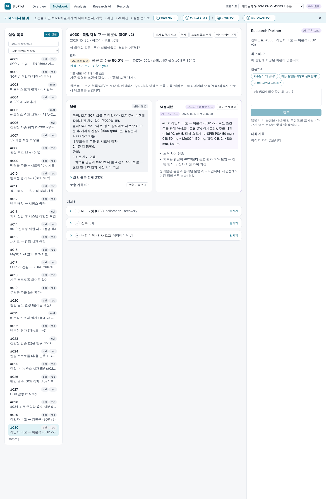 | 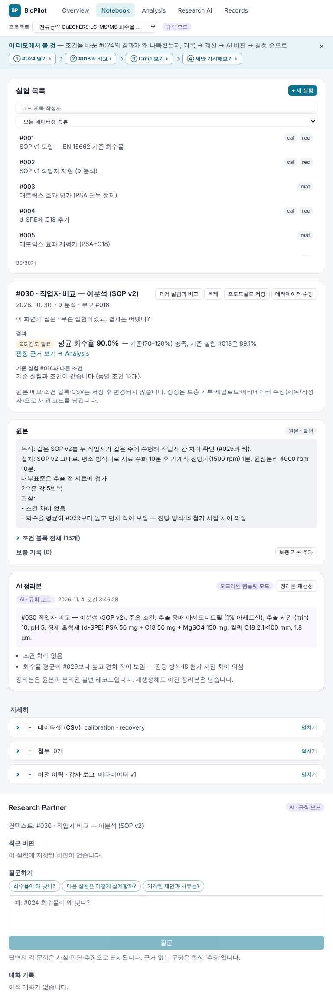 | 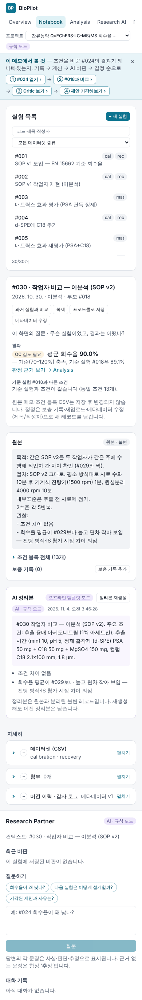 |
| 새 실험 — 조건 블록을 항목별로 입력 | 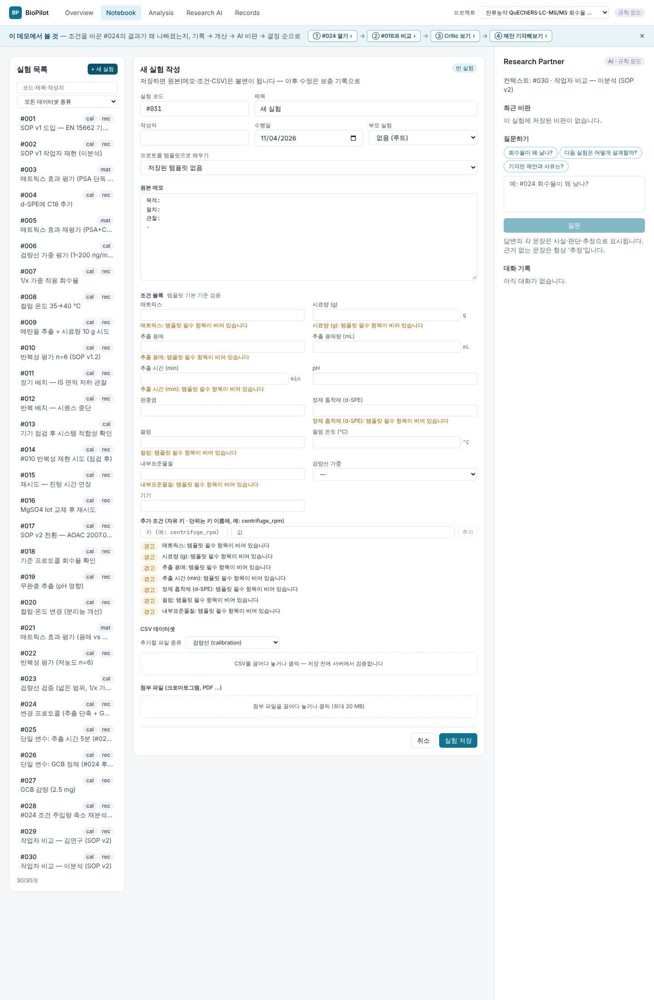 | 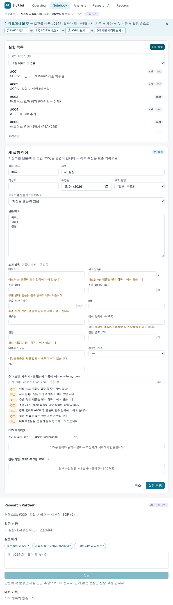 | 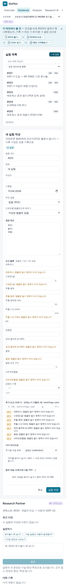 |

## 후 — Protocols 탭 (보기 3개, 질문 하나씩)

### ① 계보 — "어느 프로토콜 버전으로 한 실험이 QC를 잘 통과했나?"

답(가장 높은 QC 통과 버전과 저장된 통과 수)이 맨 위, 버전별 통과 막대, 그 아래 버전별 바뀐 조건·실험은 접힘.
시드 SOP v1 → v1.1 → v1.2 → v2. 숫자는 `GET /api/analysis/records/protocols`(저장된 QC 상태) 그대로.

| 1440 | 768 | 390 |
|---|---|---|
| 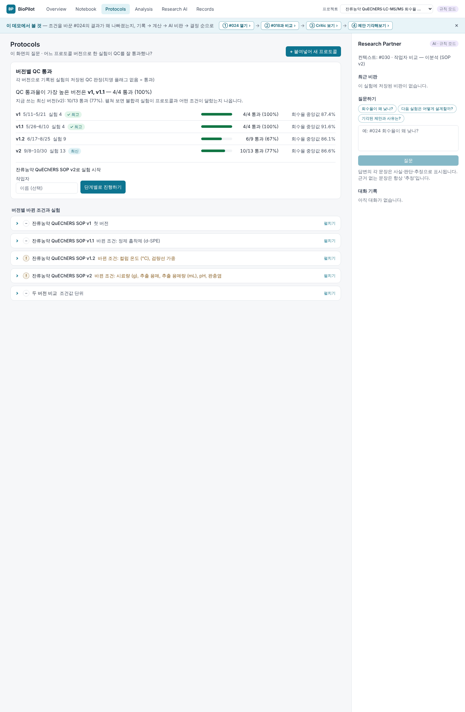 | 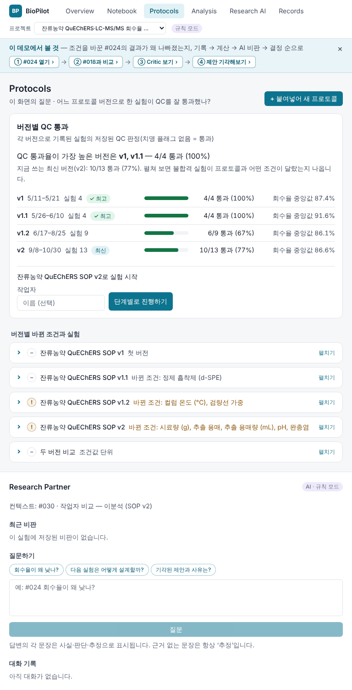 | 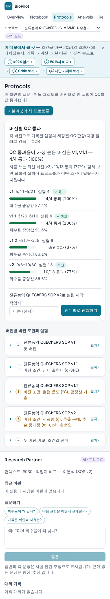 |

v2를 펼친 상태 — v1.2 대비 바뀐 조건값, v2로 기록된 실험마다 QC 표시와 "프로토콜과 다른 조건":
불합격(✕) #024·#026·#028은 모두 SOP와 정제 흡착제가 달랐던 실험이다.

| 1440 | 390 |
|---|---|
| 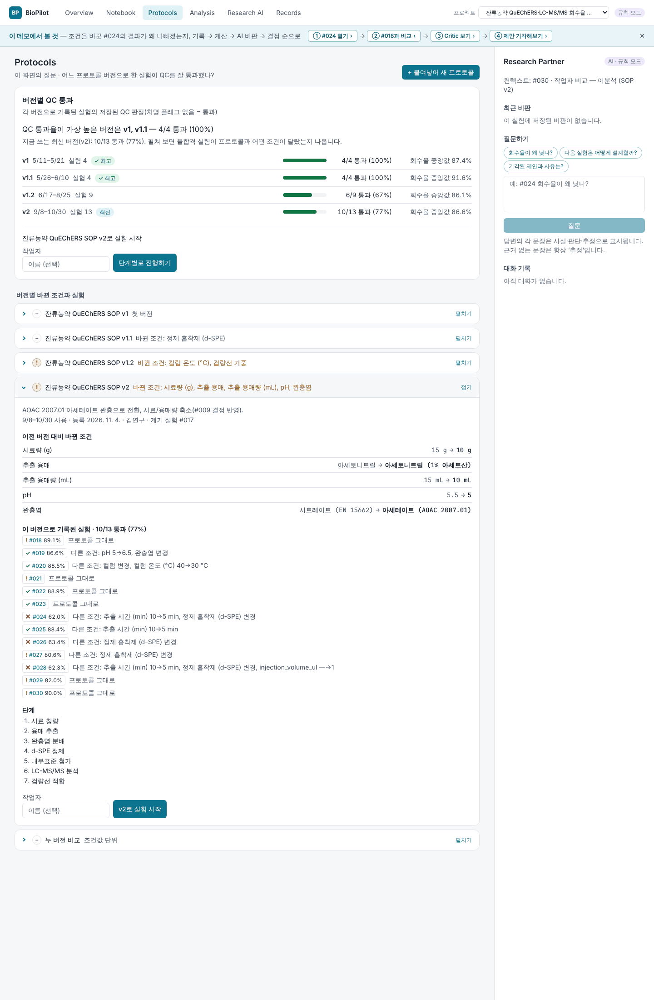 | 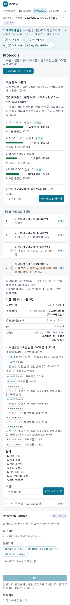 |

### ② 붙여넣기 — "붙여넣은 프로토콜에서 조건이 제대로 읽혔나?"

원문 → 규칙 추출 → 값마다 근거 줄(`원문 3행: “…”`) 표시. `35–40 °C`처럼 범위로 적힌 값은 **비워 두고**
"값이 여러 개 — 확인 필요"로, 원문에 없는 pH·검량선 가중은 "인식하지 못함"으로 접어 둔다. 연구자가 고친 칸은
"수정함". 저장 시 원문(`source_text`)과 검토 결과(채택·수정·직접 입력)가 템플릿과 함께 불변 레코드로 남는다.

| 1440 | 768 | 390 |
|---|---|---|
| 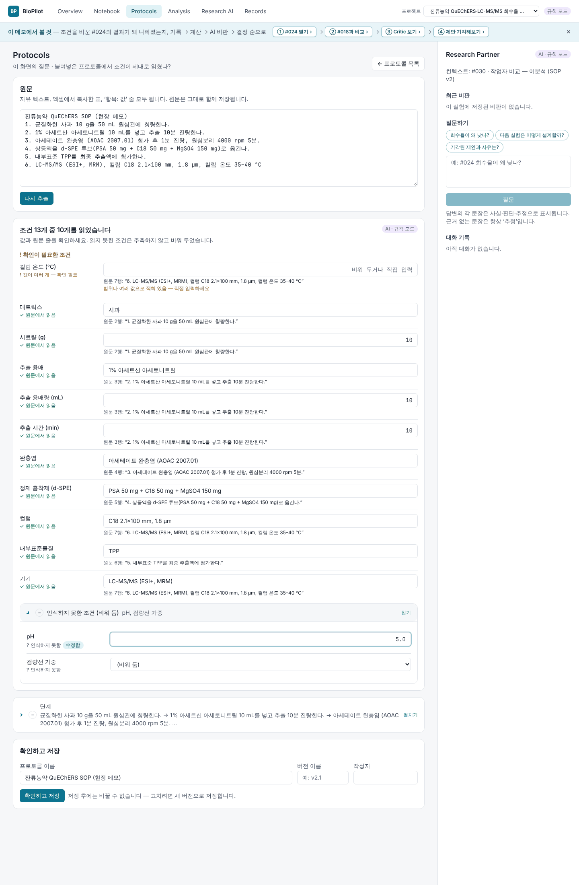 | 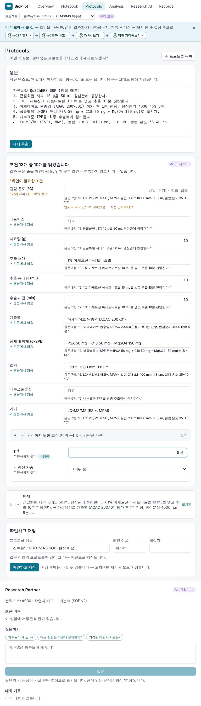 | 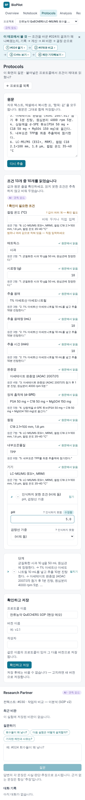 |

### ③ 실행 — "지금 할 단계와 그 조건값은?"

현재 단계와 조건값이 맨 위, 큰 "✓ 이 단계 완료" 버튼. "값이 달랐음"으로 그 자리에서 실제 값(추출 시간 10 → 7 min)과
이유를 기록하면 계획값은 취소선, 실제 값은 `!`와 함께 표시되고 "프로토콜과 다른 점"에 쌓인다(색만으로 구분하지 않음).

| 1440 | 768 | 390 |
|---|---|---|
| 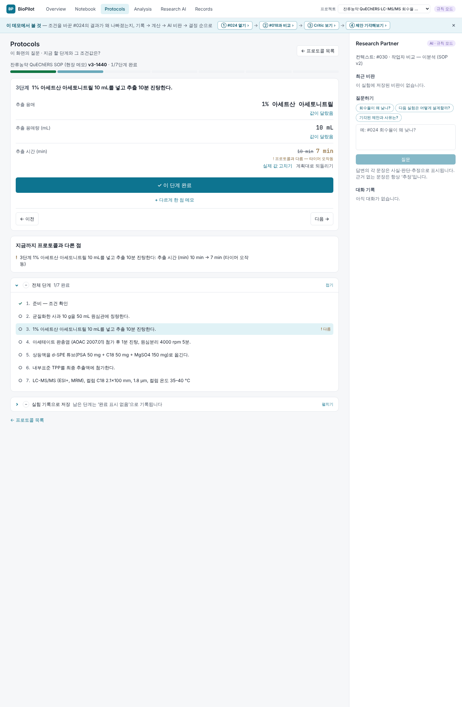 | 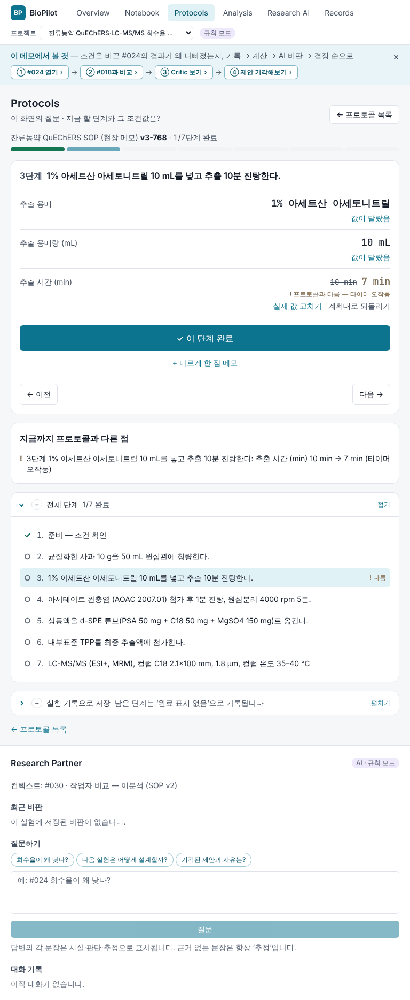 | 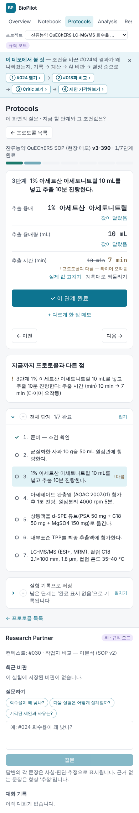 |

완료 → 실험 기록으로 저장(미리보기): 조건 블록은 실제 값으로, 원본 메모에는 단계 체크·"프로토콜과 다른 점"·관찰.

| 1440 | 768 | 390 |
|---|---|---|
| 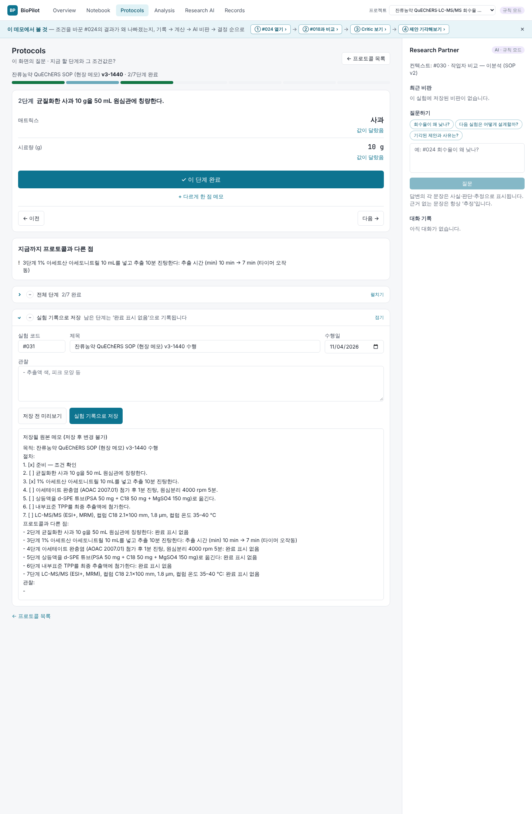 | 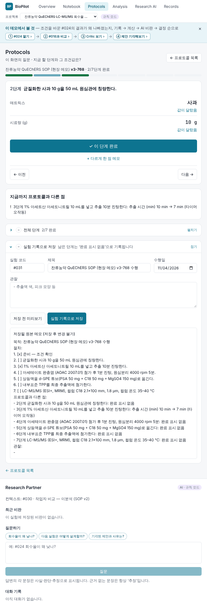 | 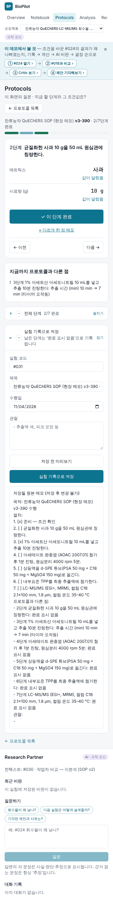 |

### Notebook (후)

변화는 한 줄 — 실험 부제의 `템플릿 #12`가 `프로토콜 잔류농약 QuEChERS SOP v2`로 바뀌었다. 화면 구성은 그대로.

| 1440 | 768 | 390 |
|---|---|---|
| 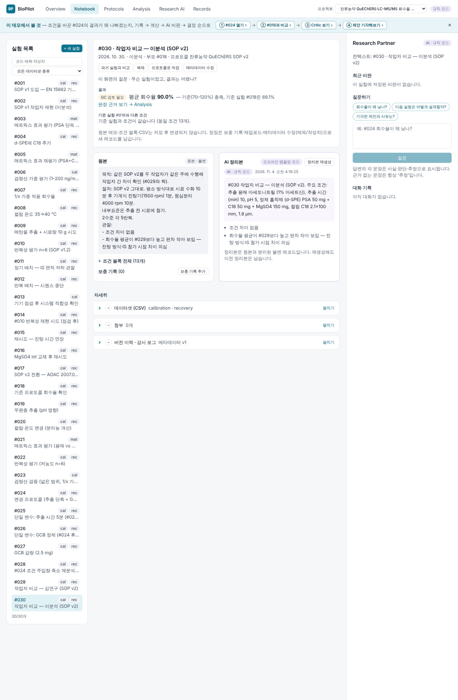 | 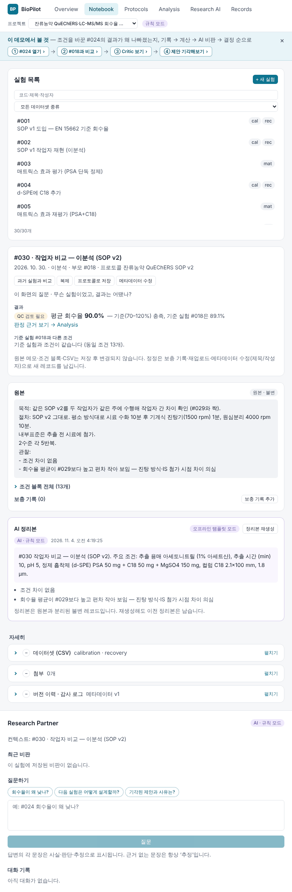 | 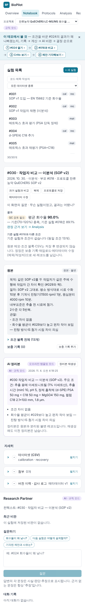 |
